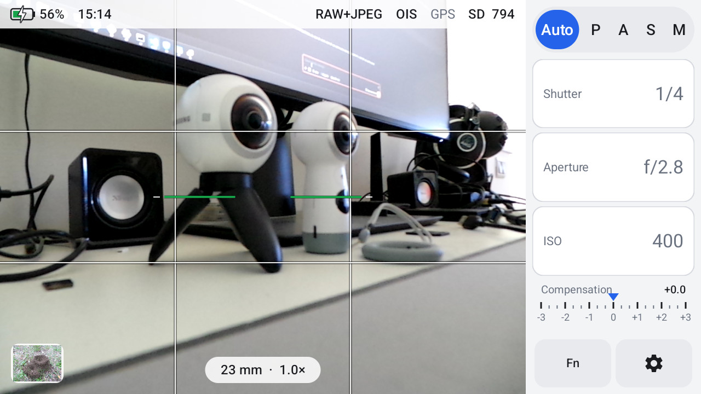
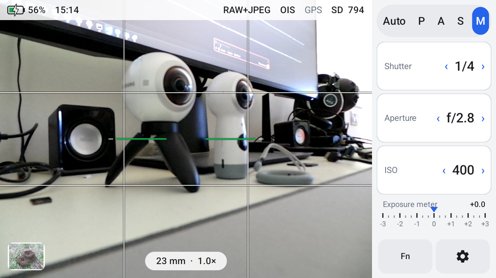
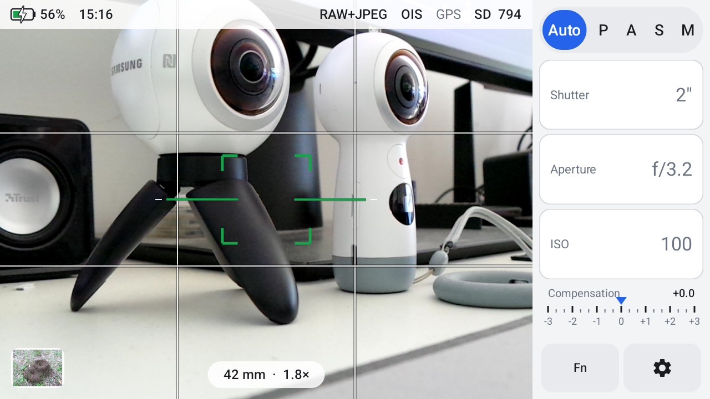
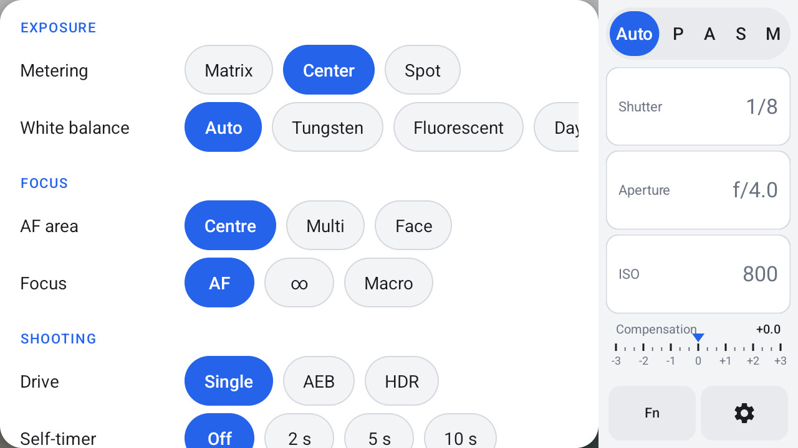
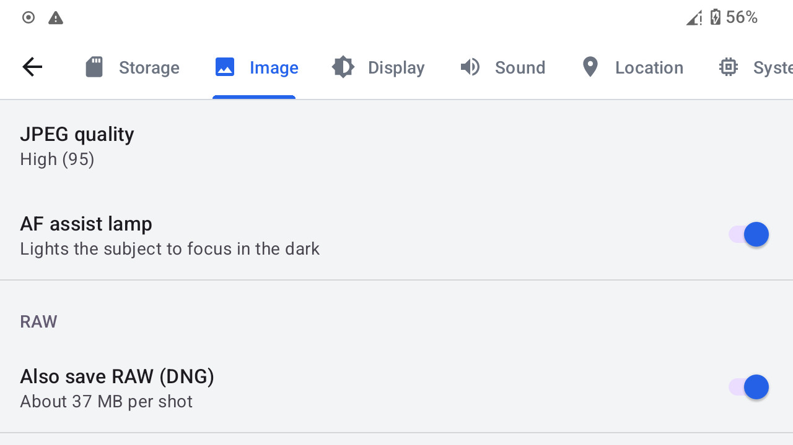
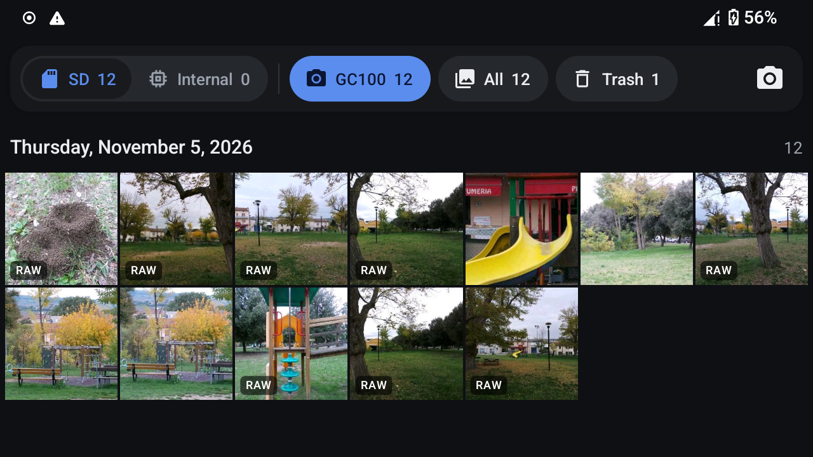
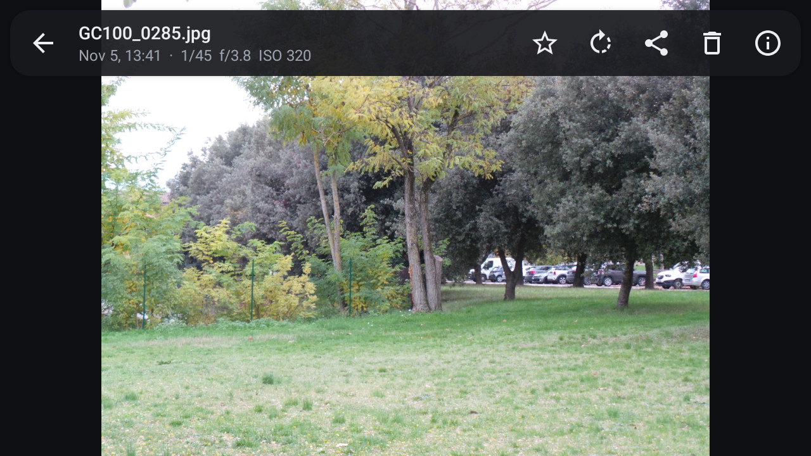
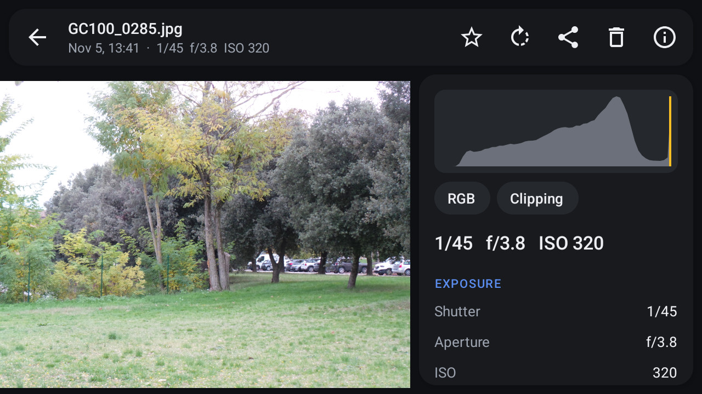

# Galaxy Camera Revived

A custom ROM that brings Android 14 (LineageOS 21) to the **Samsung Galaxy Camera** and **Galaxy Camera 2**, the Android cameras with a 21x optical zoom.

| Model | Support |
|---|---|
| Galaxy Camera **EK-GC100** (3G) | **Supported** |
| Galaxy Camera 2 **EK-GC200** (Wi-Fi) | **Supported** |
| Other variants (GC110, GC120) | Not supported |

**Download**: [Releases page](https://github.com/simoneluconi/GalaxyCameraRevived/releases). Each model has its own files: never flash one model's files on the other. **Website**: [simoneluconi.github.io/GalaxyCameraRevived](https://simoneluconi.github.io/GalaxyCameraRevived/).

Samsung's own firmware is stuck on Android 4.1 and 4.3: apps no longer install, nothing syncs, and many stock services are dead. This project puts a modern, lightweight Android on these cameras and keeps what makes them cameras: the zoom lever, the shutter button, manual exposure, optical stabilisation and the pop-up flash. It also adds something Samsung never offered: **RAW photos (DNG)**.

It is built camera-first: no Google services and no phone apps, only what a camera needs.

> **An enthusiast build.** It is used every day, but it is not a finished product: read [what works](#what-works) before you flash.

## What works

| Area | Status |
|---|---|
| Boot, screen, touch, landscape UI | Works |
| Camera: viewfinder, autofocus, 16 MP JPEG | Works |
| 21x optical zoom with the zoom lever | Works |
| Half-press focus, full-press shutter | Works |
| P / A / S / M exposure modes | Works |
| Optical image stabilisation (OIS) | Works |
| Pop-up flash, self-timer lamp, AF assist lamp | Works |
| RAW (DNG) next to the JPEG | Works |
| Exposure bracketing (3 frames) | Works |
| Lens retracts when the camera closes or reboots | Works |
| microSD (FAT32, exFAT) | Works |
| Rotation sensor, level, compass | Works |
| Wi-Fi | 2.4 GHz works. 5 GHz does not connect (on Samsung's own firmware either); on a dual-band network the camera uses 2.4 GHz by itself |
| GPS | Works |
| 3G mobile data (GC100) | Works |
| SMS (GC100) | Sending and receiving work; no voice calls (no dialer, by design) |
| Audio | Works |
| Bluetooth | Works (pairing, sending photos to a phone, photo remotes) |
| NFC (GC200) | Not supported: a phone near the tag shows a notice |
| Video recording | Not supported: GC Camera takes photos only |
| Micro-HDMI output | The camera's live view, and in GC Gallery the photo being viewed, zoom included, from 480p to 1080p. Not a copy of the screen |
| Standby battery drain | About 1%/hour with Wi-Fi on (GC100) |
| Security | SELinux is permissive and the security patch level is from early 2025 |
| Updates | By re-flashing; there is no over-the-air update |

The full list of open items is in [docs/TODO.md](docs/TODO.md).

## Features for photographers

- **The zoom lever zooms.** Slow and fast stages, as on the stock firmware, driving the 21x optical zoom (23–483 mm equivalent, f/2.8–5.9).
- **A real shutter button.** Half press to focus, full press to shoot. A tap on the screen sets the focus point; centre, multi-area and face AF are in the Fn menu.
- **P, A, S and M.** Set aperture, shutter speed (16 s to 1/2000 s) and ISO (100–3200). The camera shows the exposure it plans to use, and M mode has an exposure meter.
- **RAW (DNG).** Every shot can save a DNG next to the JPEG. The DNG is the sensor's own data, before Samsung's heavy noise reduction and sharpening. It opens in Lightroom, Camera Raw and RawTherapee, among others.
- **Lens profiles for both cameras.** With them, Lightroom and RawTherapee correct the lens's barrel distortion and corner shading in the DNGs. See [Downloads](#downloads).
- **OIS on or off**, metering (matrix, centre, spot), white balance presets, self-timer with the front lamp, and 3-frame exposure bracketing.
- **The pop-up flash works as a switch.** Raise it to use the flash, close it to turn the flash off.
- **Full EXIF.** Shutter, aperture, ISO, focal length (and 35 mm equivalent), GPS when available, orientation, artist and copyright.
- **Photos go to the microSD card**, in `DCIM/`.

It ships with two apps of its own:
- **GC Camera**: the camera app, built for the physical controls. [More](camera-app/README.md).
- **GC Gallery**: a fast gallery for the camera's photos. It pairs each JPEG with its DNG and shows the exposure info, a histogram and star ratings. [More](docs/GALLERY-APP.md).

## Screenshots

Taken on an EK-GC100 running this build (1280x720 screen).

**GC Camera**

|  |  |
|:---:|:---:|
| Auto: the panel shows the exposure the camera picked | M: shutter, aperture and ISO by hand, with the exposure meter |
|  |  |
| The zoom lever drives the optical zoom; half press focuses | The Fn menu: metering, white balance, AF, drive, self-timer |
|  | |
| Settings: JPEG quality, AF lamp, RAW (DNG) | |

**GC Gallery**

|  |  |
|:---:|:---:|
| Photos by day, RAW badges where a DNG is paired | A photo with its exposure |
|  | |
| Info: histogram with clipping, and the EXIF | |

## Install

**Read [docs/INSTALL.md](docs/INSTALL.md) before you start.** It starts with a one-page quick guide, then explains every step and how to go back to Samsung's firmware.

In short:
1. **You need**: an EK-GC100 or EK-GC200, a Windows PC with Odin 3.10.7, Samsung's USB drivers and adb, a good USB cable, a microSD card, and the battery at 50% or more.
2. **Download Samsung's official firmware** for your camera first, and keep it. With it, Odin can always bring the camera back to stock.
3. **Flash the mini recovery for your model** (`EK-GC100-…` or `EK-GC200-…`) with Odin, then **back up** the camera's own partitions with one adb command. The backup holds the camera's identity (Wi-Fi and Bluetooth addresses, IMEI on the GC100) and calibration; without it, a damaged EFS partition cannot be repaired.
4. **Flash the system for your model** with Odin, then do a factory reset from the mini recovery. The first boot takes a few minutes.

**Warnings**
- Flashing a custom system always has some risk. You do it at your own risk.
- **Never flash a PIT file and never tick "Re-Partition" in Odin.**
- **Never flash a bootloader** (`sboot.bin`, `tz.img`) or anything to the PARAM partition. A bad bootloader is the one thing Odin cannot fix.
- Don't use old custom recoveries or kernels from forums to wipe the camera. Some 2012-era kernels can permanently kill the internal memory (the Exynos "superbrick" bug).
- Never unplug the cable while Odin is writing.

## Downloads

**Builds**: on the [Releases page](https://github.com/simoneluconi/GalaxyCameraRevived/releases). Every file name starts with its model; download only your model's:

| | Galaxy Camera **EK-GC100** | Galaxy Camera 2 **EK-GC200** |
|---|---|---|
| Mini recovery | `EK-GC100-minirecovery.tar.md5` | `EK-GC200-minirecovery.tar.md5` |
| System | `EK-GC100-system-<date>.tar.md5` | `EK-GC200-system-<date>.tar.md5` |
| Lens profile | `EK-GC100-lens-profile.lcp` | `EK-GC200-lens-profile.lcp` |

Each release also has the SHA-256 checksums of all its files.

**Lens profiles**: [`EK-GC100-lens-profile.lcp`](profiles/EK-GC100-lens-profile.lcp) and [`EK-GC200-lens-profile.lcp`](profiles/EK-GC200-lens-profile.lcp), Adobe lens profiles for the zoom lens, one per camera. They correct barrel distortion at the wide end and even out the corner shading. They are meant for **RAW (DNG) files only**: the camera's JPEGs are already corrected by the camera.

- **Lightroom Classic / Camera Raw (Photoshop)**:
  1. Copy the `.lcp` file of your camera (or both) to:
     - Windows: `%APPDATA%\Adobe\CameraRaw\LensProfiles\1.0\`
     - macOS: `~/Library/Application Support/Adobe/CameraRaw/LensProfiles/1.0/`
  2. Restart Lightroom or Photoshop.
  3. DNGs from GC Camera turn the profile on by themselves, and Lightroom picks the one for the camera that took the photo. For other DNGs: Develop → Lens Corrections → Profile → Enable Profile Corrections, Make "Samsung", Model "Samsung 4.1-86.1mm f/2.8-5.9".
- **RawTherapee**: in the Transform tab, open "Profiled Lens Correction", choose "LCP file" and pick the `.lcp` of your camera. At the wide end, crop the dark corners by hand: RawTherapee does not read the crop that GC Camera stores in the DNG.

How it was measured, and its limits: [docs/LENS-PROFILE.md](docs/LENS-PROFILE.md).

## For developers

- [docs/TECHNICAL.md](docs/TECHNICAL.md): architecture, the M9MO image processor, the RAW pipeline, the source trees and how to build.
- [docs/CAMERA-APP.md](docs/CAMERA-APP.md): the camera HAL's parameters and the camera app's design.
- [docs/RECOVERY.md](docs/RECOVERY.md): the mini recovery, backups and restore.
- [docs/TODO.md](docs/TODO.md): known issues and workarounds.
- [docs/GC200.md](docs/GC200.md): the plan for the Galaxy Camera 2: what it shares with the GC100 and what a GC200 build still needs.

## Credits

This port stands on the work of many people:
- **[html6405](https://github.com/html6405)**: the LineageOS 21 trees for Exynos 4412 devices (smdk4412-common, the kernel, hardware/samsung, the i9300 device tree, the HAL1 camera framework branches). This project would not exist without them.
- **[LineageOS-UL](https://github.com/LineageOS-UL)** ("LineageOS for Ultra Legacy devices"): the Android 14 base patched for old kernels and hardware.
- **Paul Kocialkowski and the [Replicant](https://replicant.us) project**: the free `exynos_camera` HAL and the sensors HAL that our camera and sensor support are built on.
- **treammc and tubbohere**: the LineageOS kernel bring-up for the Galaxy Camera GC110 (gd1wifi), with the board files and panel fixes.
- **[FoxesInLove/RawGalaxyCamera](https://github.com/FoxesInLove/RawGalaxyCamera)**: the earlier effort to get RAW out of the GC100.
- **[adamoutler](https://github.com/adamoutler/EK-GC100_Galaxy_Camera)**: Samsung's original GC100 kernel source, published on GitHub.
- **LineageOS, AOSP and CyanogenMod contributors**, StarKissed (the 2013 GC100 recovery whose approach the mini recovery follows), and **libjpeg-turbo**.

## Licences

| Part | Licence |
|---|---|
| Kernel (fork of html6405's smdk4412 kernel, including Samsung's `m9mo.c`) | GPL-2.0 |
| Camera HAL (based on Replicant's `exynos_camera`) and sensors HAL | GPL-3.0-or-later |
| Rest of the device tree (based on LineageOS / html6405) | Apache-2.0 |
| libjpeg-turbo (`camera-app/third_party/libjpeg-turbo`) | IJG / BSD-3-Clause / zlib, see its `LICENSE.md` |
| GC Camera, GC Gallery and their shared modules (`camera-app/app`, `gallery`, `gccore`, `common`), and the planned PC tool built on gccore | GPL-3.0-or-later ([text](LICENSES/GPL-3.0-or-later.txt)), so that GPL-3 code from RawTherapee and darktable can be ported into them |
| Tools (`tools/`), the mini recovery sources (`minirecovery/`) and the manifests | Apache-2.0 ([text](LICENSES/Apache-2.0.txt)) |
| Documentation (`docs/`, this README) | CC BY 4.0 ([text](LICENSES/CC-BY-4.0.txt)) |
| Lens profile (`profiles/`) | CC0 1.0, public domain ([text](LICENSES/CC0-1.0.txt)) |
| Reference copies (`reference/`) | Their own GPL headers |

The licence of each path is declared in [`REUSE.toml`](REUSE.toml).

Samsung's proprietary files (firmware, drivers, libraries) are **not** in these repositories. They are extracted from the official firmware when the system is built.

This project is not affiliated with Samsung. "Samsung" and "Galaxy" are trademarks of Samsung Electronics.
